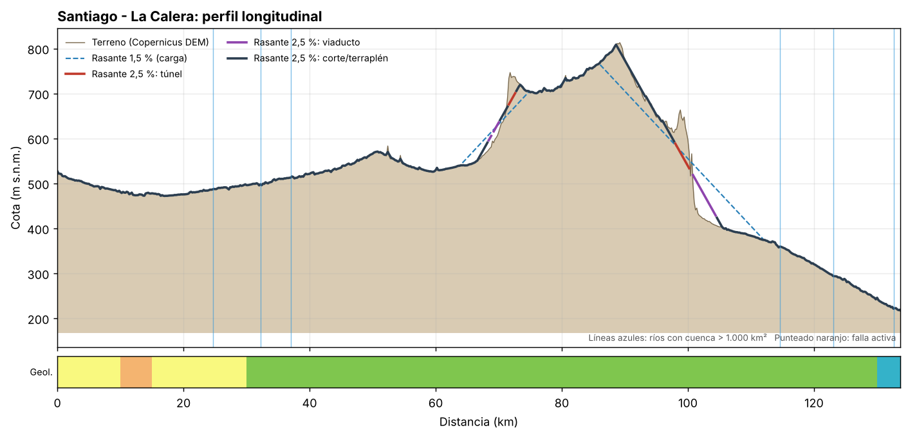
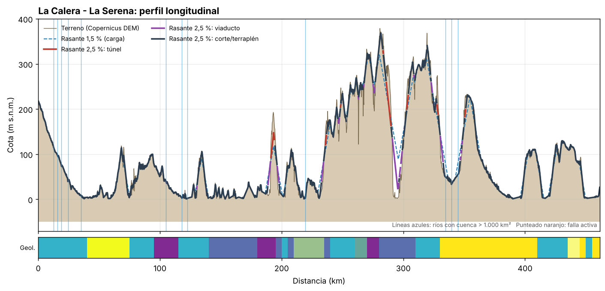
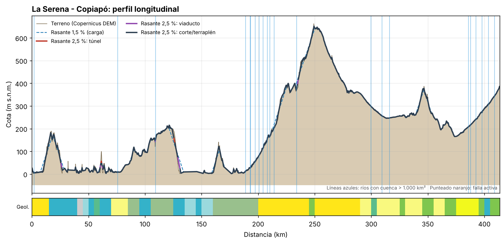
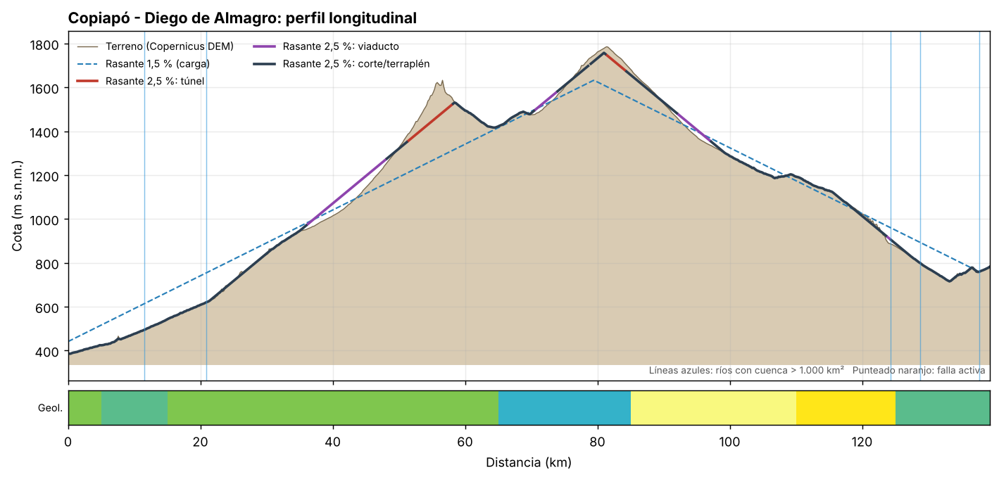
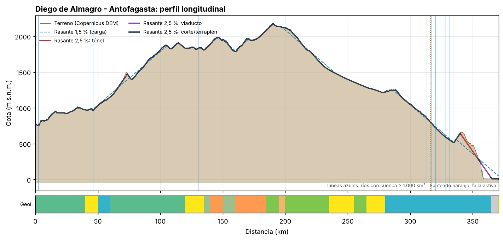

# Evaluación preliminar: santiago-antofagasta-v2

Trazado v2: corredor de menor costo por pendiente sobre el DEM, pasando por ciudades que serían estaciones. Puntos aproximados.

Resultados de nivel perfil (idea). Rasante calculada sobre el eje propuesto sin optimizar el trazado en planta; las longitudes de túnel y viaducto indican dónde el eje actual choca con el relieve, no un diseño.

## Resumen por subtramo

| Subtramo | Largo (km) | Cota mín–máx (m) | Subida acum. (m) | Túnel 2,5 % (km) | Viaducto 2,5 % (km) | Túnel 1,5 % (km) | Cruces cuenca >1.000 km² | Suelo blando (km) | Fallas cruzadas |
|---|---|---|---|---|---|---|---|---|---|
| Santiago - La Calera | 134 | 218–813 | 768 | 3.8 | 5.4 | 11.8 | 6 | 25 | 0 |
| La Calera - La Serena | 461 | 1–379 | 4895 | 12.8 | 23.0 | 32.2 | 12 | 45 | 0 |
| La Serena - Copiapó | 414 | 2–662 | 2999 | 1.6 | 4.8 | 6.6 | 22 | 90 | 0 |
| Copiapó - Diego de Almagro | 139 | 386–1785 | 1825 | 10.0 | 21.0 | 35.0 | 5 | 25 | 0 |
| Diego de Almagro - Antofagasta | 371 | 5–2180 | 2651 | 15.6 | 9.2 | 36.6 | 10 | 10 | 1 |
| **Total** | **1519** | | | **43.8** | **63.4** | **122.2** | | | |

## Santiago - La Calera

- Largo 134 km; cota entre 218 y 813 m; 9 % del eje sobre terreno con pendiente > 2,5 %.
- Rasante 2,5 %: túnel 3.8 km (km 72–73, km 98–100); viaducto 5.4 km (km 68–69, km 69–70, km 101–105); corte/terraplén medio 1.1 m.
- Rasante 1,5 %: túnel 11.8 km (km 71–74, km 87–93, km 93–94, km 98–100); viaducto 14.2 km (km 65–70, km 101–110); corte/terraplén medio 1.9 m.
- Cruces de ríos mayores: km 25 (cuenca 1.204 km². caudal medio 6.5 m³/s); km 32 (cuenca 1.183 km². caudal medio 6.4 m³/s); km 37 (cuenca 1.082 km². caudal medio 5.9 m³/s); km 115 (cuenca 5.591 km². caudal medio 28.8 m³/s); km 123 (cuenca 5.677 km². caudal medio 29.0 m³/s); km 133 (cuenca 5.863 km². caudal medio 29.6 m³/s).
- Otros 19 cruces de quebradas o esteros con cuenca entre 10 y 1.000 km² (alcantarillas o puentes menores; en el norte, riesgo de aluvión).
- Geología: 25 km sobre depósitos cuaternarios no consolidados y 105 km sobre rocas volcánicas. Unidades atravesadas:
    - km 0–10: Quaternary Siliciclastic (Quaternary; Siliciclastic)
    - km 10–15: Paleogene - Neogene Volcano-sedimentary (Cenozoic; Volcaniclastic, volcanic)
    - km 15–30: Quaternary Siliciclastic (Quaternary; Siliciclastic)
    - km 30–40: Cretaceous Granitic (Cretaceous; Granite)
    - km 40–130: Cretaceous Volcano-sedimentary (Cretaceous; Volcaniclastic, volcanic)
    - km 130–134: Jurassic Volcano-sedimentary (Jurassic; Volcaniclastic, volcanic)

## La Calera - La Serena

- Largo 461 km; cota entre 1 y 379 m; 21 % del eje sobre terreno con pendiente > 2,5 %.
- Rasante 2,5 %: túnel 12.8 km (km 191–194, km 236–237, km 248–249, km 283–284, km 286–290, km 303–304, km 328–329, km 351–351); viaducto 23.0 km (km 130–131, km 189–191, km 196–198, km 233–235, km 246–247, km 247–248, km 267–268, km 275–276, km 276–277, km 291–296, km 296–296, km 297–298, km 298–299, km 323–324, km 330–333, km 347–348, km 348–349); corte/terraplén medio 2.6 m.
- Rasante 1,5 %: túnel 32.2 km (km 191–195, km 236–238, km 248–249, km 280–285, km 286–290, km 303–309, km 319–323, km 327–329, km 350–353); viaducto 37.0 km (km 130–131, km 188–191, km 196–199, km 230–235, km 246–248, km 253–254, km 263–264, km 267–268, km 275–276, km 276–277, km 291–299, km 300–301, km 323–324, km 330–335, km 344–349); corte/terraplén medio 4.0 m.
- Cruces de ríos mayores: km 12 (cuenca 6.402 km². caudal medio 31.7 m³/s); km 16 (cuenca 6.402 km². caudal medio 31.7 m³/s); km 19 (cuenca 6.402 km². caudal medio 31.7 m³/s); km 24 (cuenca 6.637 km². caudal medio 32.8 m³/s); km 35 (cuenca 7.310 km². caudal medio 35.9 m³/s); km 105 (cuenca 1.841 km². caudal medio 9.8 m³/s); km 118 (cuenca 1.999 km². caudal medio 10.5 m³/s); km 122 (cuenca 1.982 km². caudal medio 10.3 m³/s); km 220 (cuenca 7.808 km². caudal medio 32.6 m³/s); km 335 (cuenca 1.264 km². caudal medio 2.3 m³/s); km 340 (cuenca 10.152 km². caudal medio 22.8 m³/s); km 345 (cuenca 10.126 km². caudal medio 22.8 m³/s).
- Otros 64 cruces de quebradas o esteros con cuenca entre 10 y 1.000 km² (alcantarillas o puentes menores; en el norte, riesgo de aluvión).
- Geología: 45 km sobre depósitos cuaternarios no consolidados y 85 km sobre rocas volcánicas. Unidades atravesadas:
    - km 0–25: Jurassic Volcano-sedimentary (Jurassic; Volcaniclastic, volcanic)
    - km 25–40: Jurassic Granitic (Jurassic; Granite)
    - km 40–75: Neogene - Quaternary Siliciclastic (Cenozoic; Siliciclastic)
    - km 75–95: Jurassic Granitic (Jurassic; Granite)
    - km 95–115: Triassic Volcano-sedimentary (Triassic; Volcaniclastic, volcanic)
    - km 115–140: Jurassic Granitic (Jurassic; Granite)
    - km 140–180: Triassic - Jurassic Basaltic (Mesozoic; basalt)
    - km 180–195: Triassic Siliciclastic (Triassic; Siliciclastic)
    - km 195–200: Triassic - Jurassic Granitic (Mesozoic; Granite)
    - km 200–205: Mesozoic sedimentary rocks (Jurassic; sedimentary rocks)
    - km 205–210: Triassic - Jurassic Granitic (Mesozoic; Granite)
    - km 210–235: Devonian - Carboniferous Low to medium grade (Paleozoic; Low to medium grade metamorphic)
    - km 235–240: Triassic - Jurassic Granitic (Mesozoic; Granite)
    - km 240–260: Jurassic Granitic (Jurassic; Granite)
    - km 260–270: Carboniferous - Permian Siliciclastic (Paleozoic; Siliciclastic)
    - km 270–280: Triassic Siliciclastic (Triassic; Siliciclastic)
    - km 280–310: Triassic - Jurassic Granitic (Mesozoic; Granite)
    - km 310–330: Jurassic Granitic (Jurassic; Granite)
    - km 330–410: Neogene Siliciclastic (Neogene; Siliciclastic)
    - km 410–435: Jurassic Granitic (Jurassic; Granite)
    - km 435–445: Quaternary Siliciclastic (Quaternary; Siliciclastic)
    - km 445–450: Neogene Siliciclastic (Neogene; Siliciclastic)
    - km 450–455: Mesozoic sedimentary rocks (Jurassic; sedimentary rocks)
    - km 455–461: Neogene Siliciclastic (Neogene; Siliciclastic)

## La Serena - Copiapó

- Largo 414 km; cota entre 2 y 662 m; 11 % del eje sobre terreno con pendiente > 2,5 %.
- Rasante 2,5 %: túnel 1.6 km (km 61–62, km 126–126); viaducto 4.8 km (km 26–27, km 109–109, km 129–131, km 235–236); corte/terraplén medio 1.3 m.
- Rasante 1,5 %: túnel 6.6 km (km 16–17, km 61–62, km 123–127); viaducto 15.6 km (km 9–11, km 25–27, km 62–63, km 109–109, km 128–133, km 161–161, km 215–218, km 233–236); corte/terraplén medio 2.7 m.
- Cruces de ríos mayores: km 2 (cuenca 9.441 km². caudal medio 10.6 m³/s); km 76 (cuenca 3.912 km². caudal medio 3.1 m³/s); km 109 (cuenca 2.105 km². caudal medio 0.9 m³/s); km 189 (cuenca 9.790 km². caudal medio 5.8 m³/s); km 193 (cuenca 9.756 km². caudal medio 5.7 m³/s); km 193 (cuenca 9.642 km². caudal medio 5.6 m³/s); km 197 (cuenca 9.642 km². caudal medio 5.6 m³/s); km 201 (cuenca 9.563 km². caudal medio 5.5 m³/s); km 204 (cuenca 9.377 km². caudal medio 5.5 m³/s); km 208 (cuenca 9.377 km². caudal medio 5.5 m³/s); km 210 (cuenca 9.285 km². caudal medio 5.5 m³/s); km 214 (cuenca 9.209 km². caudal medio 5.5 m³/s); km 234 (cuenca 8.186 km². caudal medio 4.9 m³/s); km 300 (cuenca 2.952 km². caudal medio 0.8 m³/s); km 309 (cuenca 3.024 km². caudal medio 0.8 m³/s); km 316 (cuenca 1.163 km². caudal medio 0.2 m³/s); km 386 (cuenca 17.986 km². caudal medio 4.7 m³/s); km 388 (cuenca 17.947 km². caudal medio 4.7 m³/s); km 392 (cuenca 17.881 km². caudal medio 4.6 m³/s); km 398 (cuenca 17.563 km². caudal medio 4.5 m³/s); km 403 (cuenca 17.319 km². caudal medio 4.4 m³/s); km 409 (cuenca 17.206 km². caudal medio 4.3 m³/s).
- Otros 56 cruces de quebradas o esteros con cuenca entre 10 y 1.000 km² (alcantarillas o puentes menores; en el norte, riesgo de aluvión).
- Geología: 90 km sobre depósitos cuaternarios no consolidados y 20 km sobre rocas volcánicas. Unidades atravesadas:
    - km 0–15: Neogene Siliciclastic (Neogene; Siliciclastic)
    - km 15–40: Jurassic Granitic (Jurassic; Granite)
    - km 40–45: Sin dato (; )
    - km 45–50: Mesozoic-Cenozoic intrusive rocks (Phanerozoic; intrusive igneous rocks)
    - km 50–55: Jurassic Granitic (Jurassic; Granite)
    - km 55–60: Mesozoic sedimentary rocks (Mesozoic; sedimentary rocks)
    - km 60–70: Jurassic Undifferentiated (Jurassic; Volcanic)
    - km 70–85: Quaternary Siliciclastic (Quaternary; Siliciclastic)
    - km 85–95: Devonian - Carboniferous Low to medium grade (Paleozoic; Low to medium grade metamorphic)
    - km 95–105: Jurassic Granitic (Jurassic; Granite)
    - km 105–125: Devonian - Carboniferous Low to medium grade (Paleozoic; Low to medium grade metamorphic)
    - km 125–135: Jurassic Granitic (Jurassic; Granite)
    - km 135–145: Mesozoic-Cenozoic intrusive rocks (Phanerozoic; intrusive igneous rocks)
    - km 145–150: Jurassic Granitic (Jurassic; Granite)
    - km 150–160: Mesozoic-Cenozoic intrusive rocks (Phanerozoic; intrusive igneous rocks)
    - km 160–200: Devonian - Carboniferous Low to medium grade (Paleozoic; Low to medium grade metamorphic)
    - km 200–245: Neogene Siliciclastic (Neogene; Siliciclastic)
    - km 245–250: Cretaceous Granitic (Cretaceous; Granite)
    - km 250–290: Neogene Siliciclastic (Neogene; Siliciclastic)
    - km 290–300: Quaternary Siliciclastic (Quaternary; Siliciclastic)
    - km 300–305: Jurassic - Cretaceous Andesitic and related (Mesozoic; Andesite and related volcanic)
    - km 305–325: Quaternary Siliciclastic (Quaternary; Siliciclastic)
    - km 325–330: Cretaceous Granitic (Cretaceous; Granite)
    - km 330–345: Quaternary Siliciclastic (Quaternary; Siliciclastic)
    - km 345–355: Cretaceous Granitic (Cretaceous; Granite)
    - km 355–365: Quaternary Siliciclastic (Quaternary; Siliciclastic)
    - km 365–375: Cretaceous Granitic (Cretaceous; Granite)
    - km 375–395: Neogene - Quaternary Siliciclastic (Cenozoic; Siliciclastic)
    - km 395–400: Cretaceous Granitic (Cretaceous; Granite)
    - km 400–405: Jurassic Undifferentiated (Jurassic; Volcanic)
    - km 405–414: Cretaceous Granitic (Cretaceous; Granite)

## Copiapó - Diego de Almagro

- Largo 139 km; cota entre 386 y 1785 m; 34 % del eje sobre terreno con pendiente > 2,5 %.
- Rasante 2,5 %: túnel 10.0 km (km 51–58, km 81–84); viaducto 21.0 km (km 36–48, km 71–74, km 92–97, km 124–124); corte/terraplén medio 4.1 m.
- Rasante 1,5 %: túnel 35.0 km (km 45–64, km 75–91); viaducto 69.8 km (km 0–42, km 70–71, km 95–108, km 122–122, km 122–136); corte/terraplén medio 12.7 m.
- Cruces de ríos mayores: km 12 (cuenca 6.677 km². caudal medio 1.6 m³/s); km 21 (cuenca 6.206 km². caudal medio 1.4 m³/s); km 124 (cuenca 1.697 km². caudal medio 0.6 m³/s); km 129 (cuenca 2.606 km². caudal medio 0.9 m³/s); km 138 (cuenca 6.345 km². caudal medio 0.3 m³/s).
- Otros 29 cruces de quebradas o esteros con cuenca entre 10 y 1.000 km² (alcantarillas o puentes menores; en el norte, riesgo de aluvión).
- Geología: 25 km sobre depósitos cuaternarios no consolidados y 100 km sobre rocas volcánicas. Unidades atravesadas:
    - km 0–5: Cretaceous Granitic (Cretaceous; Granite)
    - km 5–15: Jurassic - Cretaceous Andesitic and related (Mesozoic; Andesite and related volcanic)
    - km 15–65: Cretaceous Volcano-sedimentary (Cretaceous; Volcaniclastic, volcanic)
    - km 65–85: Jurassic Undifferentiated (Jurassic; Volcanic)
    - km 85–110: Quaternary Siliciclastic (Quaternary; Siliciclastic)
    - km 110–125: Neogene Siliciclastic (Neogene; Siliciclastic)
    - km 125–139: Jurassic - Cretaceous Andesitic and related (Mesozoic; Andesite and related volcanic)

## Diego de Almagro - Antofagasta

- Largo 371 km; cota entre 5 y 2180 m; 14 % del eje sobre terreno con pendiente > 2,5 %.
- Rasante 2,5 %: túnel 15.6 km (km 4–4, km 72–73, km 341–354); viaducto 9.2 km (km 3–4, km 357–365); corte/terraplén medio 1.1 m.
- Rasante 1,5 %: túnel 36.6 km (km 4–5, km 69–75, km 101–102, km 200–211, km 288–289, km 337–354); viaducto 57.7 km (km 2–3, km 3–4, km 46–47, km 55–66, km 76–83, km 158–159, km 224–237, km 322–331, km 356–371); corte/terraplén medio 6.4 m.
- Cruces de ríos mayores: km 2 (cuenca 6.345 km². caudal medio 0.3 m³/s); km 47 (cuenca 3.144 km². caudal medio 0.3 m³/s); km 130 (cuenca 2.098 km². caudal medio 0.2 m³/s); km 313 (cuenca 1.163 km². caudal medio 0.0 m³/s); km 317 (cuenca 1.189 km². caudal medio 0.0 m³/s); km 320 (cuenca 1.232 km². caudal medio 0.0 m³/s); km 320 (cuenca 1.516 km². caudal medio 0.0 m³/s); km 328 (cuenca 1.769 km². caudal medio 0.0 m³/s); km 331 (cuenca 1.769 km². caudal medio 0.0 m³/s); km 335 (cuenca 1.843 km². caudal medio 0.0 m³/s).
- Otros 67 cruces de quebradas o esteros con cuenca entre 10 y 1.000 km² (alcantarillas o puentes menores; en el norte, riesgo de aluvión).
- Geología: 10 km sobre depósitos cuaternarios no consolidados y 155 km sobre rocas volcánicas. Unidades atravesadas:
    - km 0–40: Jurassic - Cretaceous Andesitic and related (Mesozoic; Andesite and related volcanic)
    - km 40–50: Neogene Siliciclastic (Neogene; Siliciclastic)
    - km 50–60: Jurassic Undifferentiated (Jurassic; Volcanic)
    - km 60–120: Jurassic - Cretaceous Andesitic and related (Mesozoic; Andesite and related volcanic)
    - km 120–135: Neogene Siliciclastic (Neogene; Siliciclastic)
    - km 135–140: Devonian - Carboniferous Low to medium grade (Paleozoic; Low to medium grade metamorphic)
    - km 140–150: Paleogene Andesitic and related (Paleogene; Andesite and related volcanic)
    - km 150–160: Devonian - Carboniferous Low to medium grade (Paleozoic; Low to medium grade metamorphic)
    - km 160–185: Paleogene Andesitic and related (Paleogene; Andesite and related volcanic)
    - km 185–195: Cretaceous Rhyolitic (Cretaceous; Rhyolite)
    - km 195–200: Paleogene - Neogene Rhyolitic (Cenozoic; Rhyolite)
    - km 200–235: Cretaceous Rhyolitic (Cretaceous; Rhyolite)
    - km 235–255: Neogene Siliciclastic (Neogene; Siliciclastic)
    - km 255–265: Cretaceous Granitic (Cretaceous; Granite)
    - km 265–280: Neogene Siliciclastic (Neogene; Siliciclastic)
    - km 280–355: Jurassic Granitic (Jurassic; Granite)
    - km 355–365: Jurassic Undifferentiated (Jurassic; Volcanic)
    - km 365–370: Sin dato (; )
    - km 370–371: Neogene - Quaternary Siliciclastic (Cenozoic; Siliciclastic)
- Fallas activas cruzadas: Coloso (Normal) cerca del km 316.
- Fallas activas a menos de 10 km: nan a 2.8 km; de Atacama segmento Salar del Carmen? a 2.2 km; Bolfin a 7.1 km.

## Fuentes

- Elevación: Copernicus DEM GLO-90 (ESA), vía AWS Open Data.
- Cauces: HydroRIVERS v1.0 (WWF/HydroSHEDS). Cuencas: HydroBASINS nivel 6.
- Geología: Macrostrat (API v2), que compila mapas regionales incluido el Mapa Geológico de Chile 1:1.000.000 (Sernageomin).
- Fallas activas: GEM Global Active Faults Database.
