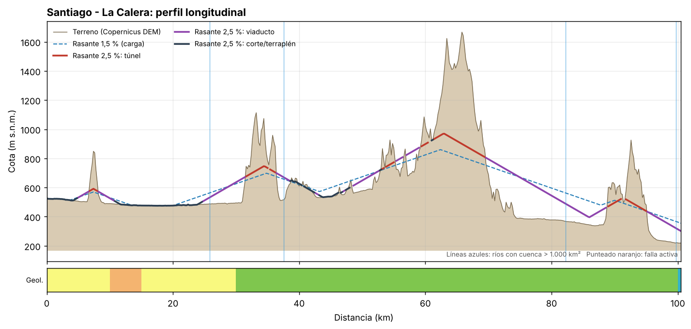
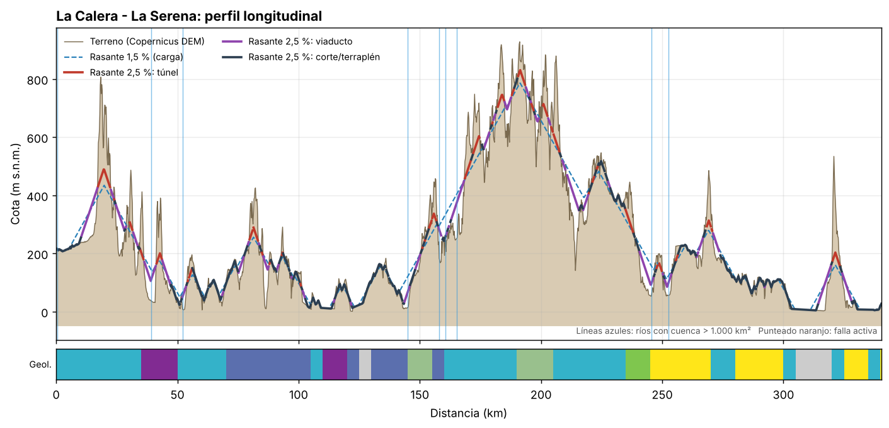
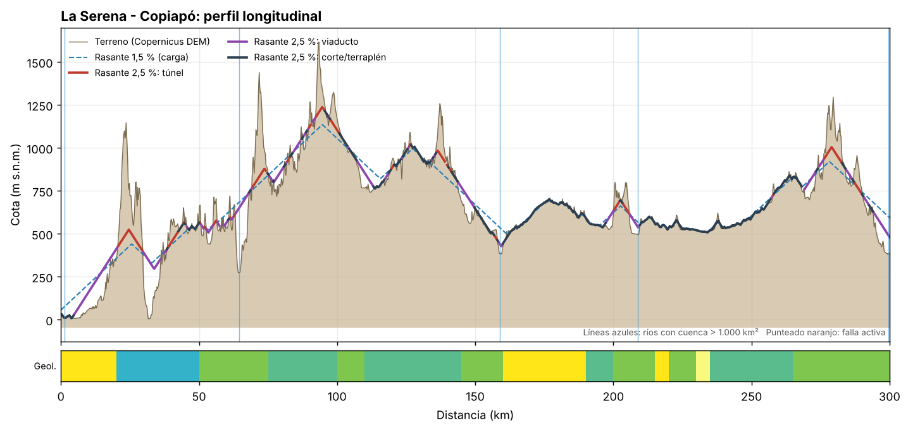
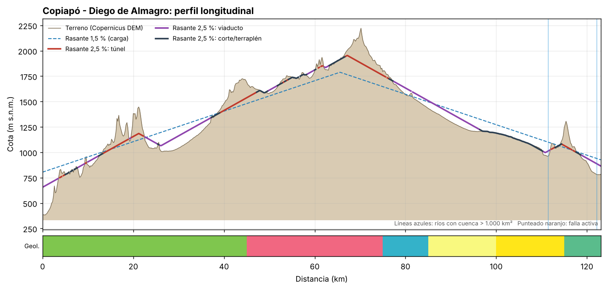
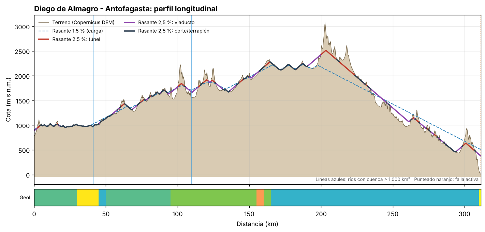

# Evaluación preliminar: santiago-antofagasta

Trazado preliminar v1: puntos de paso a lo largo del corredor Ruta 5 / antiguo Longitudinal Norte, unidos en línea recta. Coordenadas aproximadas.

Resultados de nivel perfil (idea). Rasante calculada sobre el eje propuesto sin optimizar el trazado en planta; las longitudes de túnel y viaducto indican dónde el eje actual choca con el relieve, no un diseño.

## Resumen por subtramo

| Subtramo | Largo (km) | Cota mín–máx (m) | Subida acum. (m) | Túnel 2,5 % (km) | Viaducto 2,5 % (km) | Túnel 1,5 % (km) | Cruces cuenca >1.000 km² | Suelo blando (km) | Fallas cruzadas |
|---|---|---|---|---|---|---|---|---|---|
| Santiago - La Calera | 101 | 218–1666 | 5386 | 23.8 | 46.7 | 25.6 | 4 | 25 | 0 |
| La Calera - La Serena | 340 | 1–928 | 13495 | 57.4 | 96.2 | 75.6 | 9 | 0 | 0 |
| La Serena - Copiapó | 300 | 6–1617 | 13498 | 54.0 | 89.4 | 69.4 | 5 | 5 | 0 |
| Copiapó - Diego de Almagro | 123 | 383–2222 | 4362 | 32.8 | 52.1 | 50.0 | 2 | 15 | 0 |
| Diego de Almagro - Antofagasta | 311 | 9–3074 | 10834 | 70.2 | 102.6 | 87.2 | 3 | 10 | 1 |
| **Total** | **1175** | | | **238.2** | **387.0** | **307.8** | | | |

## Santiago - La Calera

- Largo 101 km; cota entre 218 y 1666 m; 46 % del eje sobre terreno con pendiente > 2,5 %.
- Rasante 2,5 %: túnel 23.8 km (km 7–8, km 32–35, km 35–36, km 54–55, km 59–61, km 61–70, km 89–91, km 92–95); viaducto 46.7 km (km 5–7, km 8–11, km 25–32, km 36–39, km 43–43, km 49–53, km 55–57, km 57–59, km 70–89, km 95–101); corte/terraplén medio 4.4 m.
- Rasante 1,5 %: túnel 25.6 km (km 7–8, km 32–36, km 54–55, km 59–70, km 89–91, km 92–95); viaducto 54.5 km (km 5–7, km 8–12, km 22–31, km 37–39, km 42–46, km 47–48, km 48–53, km 55–57, km 57–59, km 70–89, km 95–101); corte/terraplén medio 5.4 m.
- Cruces de ríos mayores: km 26 (cuenca 1.204 km². caudal medio 6.5 m³/s); km 38 (cuenca 1.082 km². caudal medio 5.9 m³/s); km 82 (cuenca 5.232 km². caudal medio 27.1 m³/s); km 100 (cuenca 5.863 km². caudal medio 29.6 m³/s).
- Otros 13 cruces de quebradas o esteros con cuenca entre 10 y 1.000 km² (alcantarillas o puentes menores; en el norte, riesgo de aluvión).
- Geología: 25 km sobre depósitos cuaternarios no consolidados y 80 km sobre rocas volcánicas. Unidades atravesadas:
    - km 0–10: Quaternary Siliciclastic (Quaternary; Siliciclastic)
    - km 10–15: Paleogene - Neogene Volcano-sedimentary (Cenozoic; Volcaniclastic, volcanic)
    - km 15–30: Quaternary Siliciclastic (Quaternary; Siliciclastic)
    - km 30–35: Cretaceous Granitic (Cretaceous; Granite)
    - km 35–100: Cretaceous Volcano-sedimentary (Cretaceous; Volcaniclastic, volcanic)
    - km 100–101: Jurassic Volcano-sedimentary (Jurassic; Volcaniclastic, volcanic)

## La Calera - La Serena

- Largo 340 km; cota entre 1 y 928 m; 54 % del eje sobre terreno con pendiente > 2,5 %.
- Rasante 2,5 %: túnel 57.4 km (km 17–22, km 30–32, km 35–36, km 41–44, km 55–56, km 80–81, km 81–83, km 85–85, km 88–88, km 93–94, km 101–101, km 151–151, km 152–152, km 154–155, km 155–157, km 169–171, km 172–175, km 182–185, km 188–189, km 191–194, km 196–197, km 201–203, km 204–205, km 205–208, km 220–220, km 221–222, km 223–224, km 235–238, km 248–248, km 249–250, km 256–257, km 268–270, km 270–271, km 320–323); viaducto 96.2 km (km 10–17, km 23–24, km 25–28, km 32–34, km 36–41, km 44–47, km 52–54, km 68–69, km 75–78, km 79–80, km 84–84, km 85–88, km 91–92, km 97–97, km 102–103, km 114–115, km 121–122, km 144–146, km 148–150, km 158–159, km 161–161, km 163–168, km 176–179, km 180–181, km 185–188, km 194–195, km 196–196, km 198–199, km 203–204, km 209–210, km 211–216, km 217–220, km 228–229, km 241–247, km 250–251, km 251–254, km 264–265, km 265–267, km 271–274, km 292–293, km 314–320, km 324–328); corte/terraplén medio 6.6 m.
- Rasante 1,5 %: túnel 75.6 km (km 17–23, km 29–30, km 30–32, km 35–36, km 41–44, km 55–57, km 71–71, km 80–83, km 85–85, km 93–94, km 100–101, km 119–120, km 151–153, km 153–157, km 169–175, km 179–179, km 180–180, km 181–185, km 188–189, km 190–190, km 191–194, km 196–197, km 200–200, km 201–203, km 204–208, km 221–222, km 223–224, km 224–227, km 232–233, km 234–238, km 248–250, km 255–258, km 267–268, km 268–271, km 320–324); viaducto 115.0 km (km 7–17, km 23–24, km 25–29, km 32–34, km 36–41, km 45–48, km 49–50, km 50–51, km 52–54, km 67–69, km 75–78, km 85–88, km 91–92, km 97–97, km 102–104, km 114–115, km 121–122, km 127–127, km 142–150, km 158–168, km 176–179, km 180–181, km 185–188, km 194–195, km 196–196, km 197–199, km 203–204, km 209–210, km 210–220, km 240–247, km 250–251, km 251–254, km 264–267, km 271–275, km 276–277, km 289–289, km 292–293, km 302–303, km 312–318, km 325–329); corte/terraplén medio 8.4 m.
- Cruces de ríos mayores: km 1 (cuenca 5.863 km². caudal medio 29.6 m³/s); km 39 (cuenca 1.841 km². caudal medio 9.8 m³/s); km 52 (cuenca 1.932 km². caudal medio 10.0 m³/s); km 145 (cuenca 7.634 km². caudal medio 32.1 m³/s); km 158 (cuenca 1.144 km². caudal medio 2.5 m³/s); km 161 (cuenca 1.123 km². caudal medio 2.4 m³/s); km 165 (cuenca 1.092 km². caudal medio 2.3 m³/s); km 246 (cuenca 1.234 km². caudal medio 2.2 m³/s); km 252 (cuenca 10.126 km². caudal medio 22.8 m³/s).
- Otros 30 cruces de quebradas o esteros con cuenca entre 10 y 1.000 km² (alcantarillas o puentes menores; en el norte, riesgo de aluvión).
- Geología: 0 km sobre depósitos cuaternarios no consolidados y 80 km sobre rocas volcánicas. Unidades atravesadas:
    - km 0–25: Jurassic Volcano-sedimentary (Jurassic; Volcaniclastic, volcanic)
    - km 25–30: Jurassic Granitic (Jurassic; Granite)
    - km 30–35: Jurassic Volcano-sedimentary (Jurassic; Volcaniclastic, volcanic)
    - km 35–50: Triassic Volcano-sedimentary (Triassic; Volcaniclastic, volcanic)
    - km 50–70: Jurassic Granitic (Jurassic; Granite)
    - km 70–105: Triassic - Jurassic Basaltic (Mesozoic; basalt)
    - km 105–110: Mesozoic sedimentary rocks (Jurassic; sedimentary rocks)
    - km 110–120: Triassic Siliciclastic (Triassic; Siliciclastic)
    - km 120–125: Triassic - Jurassic Granitic (Mesozoic; Granite)
    - km 125–130: Sin dato (; )
    - km 130–145: Triassic - Jurassic Granitic (Mesozoic; Granite)
    - km 145–155: Devonian - Carboniferous Low to medium grade (Paleozoic; Low to medium grade metamorphic)
    - km 155–160: Triassic - Jurassic Granitic (Mesozoic; Granite)
    - km 160–190: Jurassic Granitic (Jurassic; Granite)
    - km 190–205: Devonian - Carboniferous Low to medium grade (Paleozoic; Low to medium grade metamorphic)
    - km 205–235: Jurassic Granitic (Jurassic; Granite)
    - km 235–245: Cretaceous Granitic (Cretaceous; Granite)
    - km 245–270: Neogene Siliciclastic (Neogene; Siliciclastic)
    - km 270–280: Jurassic Granitic (Jurassic; Granite)
    - km 280–300: Neogene Siliciclastic (Neogene; Siliciclastic)
    - km 300–305: Jurassic Granitic (Jurassic; Granite)
    - km 305–320: Sin dato (; )
    - km 320–325: Jurassic Granitic (Jurassic; Granite)
    - km 325–335: Neogene Siliciclastic (Neogene; Siliciclastic)
    - km 335–340: Mesozoic sedimentary rocks (Jurassic; sedimentary rocks)
    - km 340–340: Neogene Siliciclastic (Neogene; Siliciclastic)

## La Serena - Copiapó

- Largo 300 km; cota entre 6 y 1617 m; 59 % del eje sobre terreno con pendiente > 2,5 %.
- Rasante 2,5 %: túnel 54.0 km (km 21–30, km 39–39, km 39–43, km 44–45, km 52–53, km 55–57, km 61–62, km 69–74, km 82–82, km 83–83, km 90–91, km 92–96, km 98–101, km 120–121, km 126–127, km 136–139, km 141–141, km 157–158, km 200–202, km 203–206, km 276–277, km 277–283, km 287–290); viaducto 89.4 km (km 5–18, km 18–21, km 30–36, km 46–46, km 51–52, km 53–55, km 57–58, km 59–60, km 60–61, km 62–62, km 63–68, km 69–69, km 75–76, km 76–77, km 77–81, km 84–87, km 88–89, km 92–92, km 97–97, km 104–104, km 107–113, km 117–118, km 118–119, km 123–124, km 126–126, km 134–135, km 135–136, km 144–150, km 158–160, km 197–200, km 206–210, km 257–258, km 269–273, km 275–276, km 284–286, km 286–287, km 291–293, km 294–300); corte/terraplén medio 6.2 m.
- Rasante 1,5 %: túnel 69.4 km (km 21–30, km 39–46, km 52–53, km 55–57, km 69–75, km 87–88, km 89–89, km 90–92, km 92–97, km 97–102, km 120–121, km 124–125, km 126–127, km 135–144, km 200–203, km 203–206, km 223–223, km 238–238, km 258–258, km 276–284, km 287–290); viaducto 110.4 km (km 0–18, km 30–36, km 37–38, km 51–52, km 53–55, km 57–58, km 59–61, km 62–63, km 63–68, km 69–69, km 75–81, km 81–82, km 84–87, km 88–89, km 107–119, km 123–124, km 131–131, km 144–150, km 150–151, km 151–161, km 196–200, km 206–210, km 224–225, km 253–253, km 254–256, km 257–258, km 268–269, km 269–273, km 275–276, km 285–286, km 290–300); corte/terraplén medio 7.6 m.
- Cruces de ríos mayores: km 1 (cuenca 9.441 km². caudal medio 10.6 m³/s); km 65 (cuenca 3.213 km². caudal medio 2.6 m³/s); km 159 (cuenca 8.186 km². caudal medio 4.9 m³/s); km 209 (cuenca 2.474 km². caudal medio 0.7 m³/s); km 300 (cuenca 17.206 km². caudal medio 4.3 m³/s).
- Otros 39 cruces de quebradas o esteros con cuenca entre 10 y 1.000 km² (alcantarillas o puentes menores; en el norte, riesgo de aluvión).
- Geología: 5 km sobre depósitos cuaternarios no consolidados y 100 km sobre rocas volcánicas. Unidades atravesadas:
    - km 0–20: Neogene Siliciclastic (Neogene; Siliciclastic)
    - km 20–50: Jurassic Granitic (Jurassic; Granite)
    - km 50–75: Cretaceous Granitic (Cretaceous; Granite)
    - km 75–100: Jurassic - Cretaceous Andesitic and related (Mesozoic; Andesite and related volcanic)
    - km 100–110: Cretaceous Granitic (Cretaceous; Granite)
    - km 110–145: Jurassic - Cretaceous Andesitic and related (Mesozoic; Andesite and related volcanic)
    - km 145–160: Cretaceous Granitic (Cretaceous; Granite)
    - km 160–190: Neogene Siliciclastic (Neogene; Siliciclastic)
    - km 190–200: Jurassic - Cretaceous Andesitic and related (Mesozoic; Andesite and related volcanic)
    - km 200–215: Cretaceous Siliciclastic (Cretaceous; Siliciclastic)
    - km 215–220: Neogene Siliciclastic (Neogene; Siliciclastic)
    - km 220–230: Cretaceous Siliciclastic (Cretaceous; Siliciclastic)
    - km 230–235: Quaternary Siliciclastic (Quaternary; Siliciclastic)
    - km 235–265: Jurassic - Cretaceous Andesitic and related (Mesozoic; Andesite and related volcanic)
    - km 265–300: Cretaceous Granitic (Cretaceous; Granite)

## Copiapó - Diego de Almagro

- Largo 123 km; cota entre 383 y 2222 m; 63 % del eje sobre terreno con pendiente > 2,5 %.
- Rasante 2,5 %: túnel 32.8 km (km 4–4, km 5–5, km 9–10, km 13–19, km 20–22, km 39–47, km 54–54, km 61–61, km 61–62, km 67–76, km 76–76, km 112–113, km 115–117, km 117–118); viaducto 52.1 km (km 0–4, km 8–9, km 10–12, km 19–20, km 23–25, km 26–37, km 50–52, km 58–60, km 62–63, km 77–81, km 82–96, km 110–112, km 119–123); corte/terraplén medio 7.8 m.
- Rasante 1,5 %: túnel 50.0 km (km 14–19, km 20–22, km 39–50, km 51–79, km 114–117); viaducto 62.3 km (km 0–9, km 10–13, km 23–37, km 82–112, km 113–113, km 118–123); corte/terraplén medio 13.7 m.
- Cruces de ríos mayores: km 111 (cuenca 1.681 km². caudal medio 0.6 m³/s); km 122 (cuenca 6.345 km². caudal medio 0.3 m³/s).
- Otros 11 cruces de quebradas o esteros con cuenca entre 10 y 1.000 km² (alcantarillas o puentes menores; en el norte, riesgo de aluvión).
- Geología: 15 km sobre depósitos cuaternarios no consolidados y 85 km sobre rocas volcánicas. Unidades atravesadas:
    - km 0–5: Cretaceous Granitic (Cretaceous; Granite)
    - km 5–15: Cretaceous Volcano-sedimentary (Cretaceous; Volcaniclastic, volcanic)
    - km 15–25: Cretaceous Granitic (Cretaceous; Granite)
    - km 25–45: Cretaceous Volcano-sedimentary (Cretaceous; Volcaniclastic, volcanic)
    - km 45–75: Cretaceous - Paleogene Volcano-sedimentary (Phanerozoic; Volcaniclastic, volcanic)
    - km 75–85: Jurassic Undifferentiated (Jurassic; Volcanic)
    - km 85–100: Quaternary Siliciclastic (Quaternary; Siliciclastic)
    - km 100–115: Neogene Siliciclastic (Neogene; Siliciclastic)
    - km 115–123: Jurassic - Cretaceous Andesitic and related (Mesozoic; Andesite and related volcanic)

## Diego de Almagro - Antofagasta

- Largo 311 km; cota entre 9 y 3074 m; 64 % del eje sobre terreno con pendiente > 2,5 %.
- Rasante 2,5 %: túnel 70.2 km (km 2–4, km 16–17, km 47–47, km 60–63, km 74–77, km 81–82, km 91–92, km 95–96, km 100–105, km 115–116, km 118–121, km 124–126, km 143–146, km 161–164, km 187–187, km 200–211, km 213–224, km 231–232, km 264–265, km 266–268, km 274–275, km 275–276, km 279–280, km 299–307); viaducto 102.6 km (km 0–2, km 14–15, km 17–18, km 45–46, km 55–56, km 56–58, km 58–60, km 69–72, km 78–80, km 88–89, km 93–95, km 96–100, km 105–114, km 122–123, km 127–132, km 136–139, km 140–141, km 150–157, km 183–184, km 191–198, km 199–200, km 230–230, km 234–235, km 235–246, km 246–247, km 248–263, km 265–266, km 269–271, km 272–273, km 277–279, km 282–283, km 283–285, km 294–298, km 308–311); corte/terraplén medio 7.7 m.
- Rasante 1,5 %: túnel 87.2 km (km 2–5, km 15–17, km 60–65, km 74–77, km 81–82, km 85–86, km 89–91, km 91–92, km 95–96, km 100–105, km 115–116, km 117–121, km 123–126, km 144–146, km 158–166, km 186–188, km 197–234, km 235–235, km 267–267, km 300–305, km 305–306); viaducto 129.2 km (km 0–2, km 14–15, km 17–18, km 40–47, km 48–51, km 53–53, km 57–58, km 67–72, km 78–79, km 87–89, km 93–95, km 96–100, km 106–114, km 122–123, km 127–133, km 134–142, km 150–156, km 182–184, km 235–236, km 236–237, km 237–246, km 246–264, km 265–266, km 268–300, km 306–311); corte/terraplén medio 9.3 m.
- Cruces de ríos mayores: km 41 (cuenca 3.144 km². caudal medio 0.3 m³/s); km 110 (cuenca 3.029 km². caudal medio 0.2 m³/s); km 110 (cuenca 1.298 km². caudal medio 0.1 m³/s).
- Otros 40 cruces de quebradas o esteros con cuenca entre 10 y 1.000 km² (alcantarillas o puentes menores; en el norte, riesgo de aluvión).
- Geología: 10 km sobre depósitos cuaternarios no consolidados y 120 km sobre rocas volcánicas. Unidades atravesadas:
    - km 0–30: Jurassic - Cretaceous Andesitic and related (Mesozoic; Andesite and related volcanic)
    - km 30–45: Neogene Siliciclastic (Neogene; Siliciclastic)
    - km 45–50: Jurassic Undifferentiated (Jurassic; Volcanic)
    - km 50–95: Jurassic - Cretaceous Andesitic and related (Mesozoic; Andesite and related volcanic)
    - km 95–155: Cretaceous Granitic (Cretaceous; Granite)
    - km 155–160: Paleogene Andesitic and related (Paleogene; Andesite and related volcanic)
    - km 160–165: Cretaceous Rhyolitic (Cretaceous; Rhyolite)
    - km 165–190: Jurassic Undifferentiated (Jurassic; Volcanic)
    - km 190–300: Jurassic Granitic (Jurassic; Granite)
    - km 300–310: Jurassic Undifferentiated (Jurassic; Volcanic)
    - km 310–311: Neogene - Quaternary Siliciclastic (Cenozoic; Siliciclastic)
- Fallas activas cruzadas: de Atacama segmento Salar del Carmen? (Normal) cerca del km 311.

## Fuentes

- Elevación: Copernicus DEM GLO-90 (ESA), vía AWS Open Data.
- Cauces: HydroRIVERS v1.0 (WWF/HydroSHEDS). Cuencas: HydroBASINS nivel 6.
- Geología: Macrostrat (API v2), que compila mapas regionales incluido el Mapa Geológico de Chile 1:1.000.000 (Sernageomin).
- Fallas activas: GEM Global Active Faults Database.
